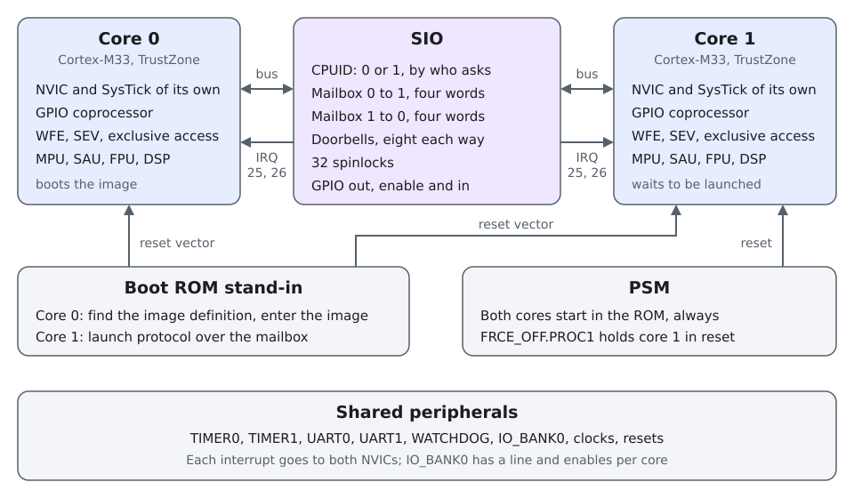

..
   Copyright (c) 2026 Muhammad Waleed Badar
   SPDX-License-Identifier: GPL-3.0-only

The two cores
#############

The RP2350 has two Cortex-M33 cores that share one address space, one set
of peripherals and one boot ROM. This page follows a core from reset to
running code and says, for each step, what the model does.

         ROM stand-in that both start from, the PSM that can reset core 1,
         and the peripherals they share
   :width: 860
   :align: center

Reset
*****

Both cores leave reset at the same time and both start in the boot ROM,
from the vector table at address 0. That holds for every reset: power-on, a
``SYSRESETREQ`` from either core, a watchdog reset, and ``machine Reset``
in the Monitor.

Renode would rather start a Cortex-M from the vector table of the last ELF
file loaded, which would send both cores straight into the image. The PSM
model overrules that: every time the machine starts or resumes, it points
the cores that are still in reset at the ROM.

.. _boot-rom:

The boot ROM stand-in
*********************

The silicon boot ROM is not part of this repository. ``bootrom/`` holds a
stand-in of a few hundred bytes that does what a system with two cores
needs and nothing more. It reads the CPUID register of the SIO first, and
the two cores part ways there.

Core 0
======

Core 0 looks for an image the way the silicon ROM does, by its image
definition: a block that starts with ``0xffffded3``, ends with
``0xab123579`` and lies within the first 4 kB of the image. The stand-in
reads three items in it:

.. list-table::
   :header-rows: 1
   :widths: 25 75

   * - Item
     - Use
   * - ``IMAGE_DEF``
     - Required. The image has to be an executable for Arm on the RP2350.
   * - ``VECTOR_TABLE``
     - Where the vector table is. Without it, at the start of the image.
   * - ``ENTRY_POINT``
     - Entry point, stack pointer and, optionally, stack limit. Without
       it, the first two words of the vector table.

It then sets VTOR, the stack pointer and the stack limit, and enters the
image. Flash is searched first, at ``0x10000000``. Main SRAM, at
``0x20000000``, is searched second, so that a RAM-only image loaded by
Renode starts without further setup; the silicon ROM only boots from RAM
when asked to.

Signatures, hashes, partitions, the RISC-V cores, and USB and UART boot are
not there. With nothing to boot, core 0 stops at the symbol
``rom_no_bootable_image``.

The ROM runs on a stack in BOOTRAM, the 1 kB of RAM the chip sets aside for
it, and leaves main SRAM untouched.

.. _launch-protocol:

Core 1
======

Core 1 waits in the ROM until core 0 sends it three things over the
mailbox: a vector table, a stack pointer and an entry point. The exchange
is the one the silicon ROM uses, and
``multicore_launch_core1()`` of the Pico SDK drives it unchanged.

.. list-table::
   :header-rows: 1
   :widths: 30 30 40

   * - Core 0 sends
     - Core 1 answers
     - Core 1 then
   * - ``0``
     - ``0``
     - starts over
   * - ``0``
     - ``0``
     - starts over
   * - ``1``
     - ``1``
     - expects the vector table
   * - vector table
     - the same word
     - expects the stack pointer
   * - stack pointer
     - the same word
     - expects the entry point
   * - entry point
     - the same word
     - sets VTOR and the stack pointer, and calls the entry point

Starting over means: empty the mailbox, send ``0``, wait for a ``1``. A
``0`` at any point, or anything but ``1`` as the first word, makes core 1
start over, and the ``0`` it then sends is the echo core 0 is waiting for.
That is why core 0 opens with zeroes: they bring the two sides into step
whatever state core 1 was in. Core 0 has to empty its own side of the
mailbox before each zero, because core 1 also sends a ``0`` when it first
arrives in the ROM.

While it waits, core 1 sleeps in ``WFE`` with ``SLEEPDEEP`` set. It uses no
stack: it has none until core 0 gives it one.

ROM functions
=============

Software finds ROM functions through pointers at fixed addresses in the
ROM. The stand-in has the magic number, the version and the lookup function
where the silicon ROM has them, and a table with these entries:

.. list-table::
   :header-rows: 1
   :widths: 12 30 58

   * - Code
     - Function
     - In the stand-in
   * - ``RB``
     - ``reboot``
     - Normal and flash-update reboots reset the chip, at once. Other
       kinds return "not permitted".
   * - ``SR``
     - ``bootrom_state_reset``
     - Nothing to do: the state it would reset lives in the model.
   * - ``SS``
     - ``set_bootrom_stack``
     - Accepted; the functions here need no stack of their own.
   * - ``WV``
     - ``wait_for_vector``
     - The core 1 side of the launch protocol, for a core that has to give
       itself back to the ROM.

A lookup of anything else returns a null pointer.

The SIO
*******

The SIO is where the cores meet. Most of its registers read differently
depending on which core asks, so the model looks at which CPU is on the
bus for every access.

.. list-table::
   :header-rows: 1
   :widths: 28 72

   * - Register
     - Behaviour
   * - ``CPUID``
     - 0 on core 0, 1 on core 1.
   * - ``FIFO_WR``, ``FIFO_RD``
     - The two mailboxes, one in each direction, **four** words deep. The
       RP2040 had eight.
   * - ``FIFO_ST``
     - ``VLD``: this core has something to read. ``RDY``: this core can
       write. ``WOF`` and ``ROE``: a write to a full or a read from an
       empty mailbox was dropped; sticky, cleared by writing 1.
   * - ``SPINLOCK0`` to ``31``
     - Reading claims the lock and returns nonzero, or returns 0 if it is
       taken. Writing releases it. ``SPINLOCK_ST`` shows all 32.
   * - ``DOORBELL_OUT_*``
     - Set, clear and read the eight doorbells of the other core.
   * - ``DOORBELL_IN_*``
     - Set, clear and read the eight doorbells of this core.
   * - ``GPIO_OUT``, ``GPIO_OE``
     - Output level and output enable of the 48 GPIOs, with the registers
       that set, clear and toggle bits in them.
   * - ``GPIO_IN``
     - The level on the pins.

An access from the Monitor counts as one from core 0.

The interpolators, the TMDS encoder, the RISC-V timer and soft interrupts,
and the Non-secure copy of the SIO are not modelled.

Interrupts
**********

Each core has its own NVIC, with 16 priority levels, and its own SysTick.
Peripheral interrupts are wired to both NVICs and software decides which
core enables which. Three sources have a line for each core instead:

.. list-table::
   :header-rows: 1
   :widths: 12 28 60

   * - IRQ
     - Source
     - Routing
   * - 0 to 3
     - TIMER0 alarms
     - To both cores
   * - 4 to 7
     - TIMER1 alarms
     - To both cores
   * - 21
     - GPIO, ``IO_BANK0``
     - One line per core, with the enables in ``PROC0_INTE`` and
       ``PROC1_INTE``
   * - 25
     - Mailbox, ``SIO_IRQ_FIFO``
     - One line per core: this core's ``VLD``, ``WOF`` or ``ROE``
   * - 26
     - Doorbells, ``SIO_IRQ_BELL``
     - One line per core: any of this core's doorbells
   * - 33, 34
     - UART0, UART1
     - To both cores

A level-sensitive line that goes high leaves its interrupt pending even if
it goes low again before the interrupt is enabled. The zero that core 1
sends on arriving in the ROM does that to the mailbox interrupt of core 0,
which is why software that enables that interrupt later is entered once
with nothing to read. The chip does the same.

Resetting core 1
****************

``FRCE_OFF.PROC1`` in the PSM holds core 1 in reset. When the bit is
cleared, core 1 and its NVIC are reset and the core goes through the boot
ROM again: it empties its mailbox, sends ``0``, and waits to be launched.
``multicore_reset_core1()`` of the Pico SDK relies on exactly that.

A reset of the whole machine ends a hold that software left in place.

Coprocessors
************

The RP2350 adds three coprocessors to each core. Renode's Cortex-M has no
coprocessor port; ``RP2350_CortexM33`` catches the instructions as they are
translated and carries them out itself.

.. list-table::
   :header-rows: 1
   :widths: 10 22 68

   * - Number
     - Coprocessor
     - In the model
   * - 0
     - GPIO
     - Complete. The Pico SDK uses it for every GPIO access, and so does
       Zephyr's GPIO driver.
   * - 4
     - Double precision
     - Only the instruction that reads the status and clears the engaged
       flag, which start-up code runs on every core. Arithmetic is not
       modelled.
   * - 7
     - Redundancy
     - Every check passes and every value reads as 0, apart from the salt
       status that start-up code asks for.

Waiting for events
******************

``WFE`` puts a core to sleep until an event; ``SEV`` on either core is an
event for both. The mailbox code on both sides is built on the pair, and so
is the wait of core 1 in the boot ROM. The events that end a ``WFE`` in the
model are:

.. list-table::
   :header-rows: 1
   :widths: 40 60

   * - Event
     - In the model
   * - ``SEV`` on either core
     - Yes
   * - An interrupt that would be taken
     - Yes
   * - A pending interrupt, with ``SEVONPEND``
     - Yes
   * - Return from an exception
     - Yes
   * - Clearing of the exclusive-access monitor
     - Stood in for, see below

The last one matters more than it looks. On this chip a core gets an event
whenever its exclusive-access monitor is cleared, which is on every
``STREX``, and the Pico SDK counts on it: its locks are built from
``LDAEXB`` and ``STREXB``, and each lock operation is followed by one
``WFE`` whose only job is to use that event up. Renode gives a model no way
to see the monitor. Without the event, that ``WFE`` swallows the wake-up
meant for the next one, and the core never wakes.

As a stand-in, a core that has slept in ``WFE`` for 1 ms is given an event.
``WFE`` is allowed to return early at any time, so correct software sees
nothing but the delay. ``wfeEventPeriod`` on a CPU in the platform
description sets the time in microseconds, and 0 turns it off. Renode can
also make ``WFE`` and ``SEV`` do nothing at all, at the price of cores that
spin instead of sleeping:

.. code-block:: none

   cpu0 WfeAndSevAsNop true
   cpu1 WfeAndSevAsNop true

Exclusive access itself, ``LDREX`` and ``STREX`` and their relatives, is
Renode's and works across the cores.

How the cores run
*****************

Renode runs each core in a thread of its own and lets them run freely for a
quantum of virtual time, 100 µs by default, before it brings them into
step. Inside a quantum the order in which the cores touch a shared register
depends on the host, as it depends on the silicon on the chip. Two settings
change that:

.. code-block:: none

   emulation SetGlobalSerialExecution true
   emulation SetGlobalQuantum "0.00001"

The first makes the cores take turns, which makes a run repeat exactly. The
second shortens the quantum, here to 10 µs, which bounds how far apart the
cores can drift at the cost of speed.

Every model in this repository locks around its register accesses, so both
cores can use them in either mode.
